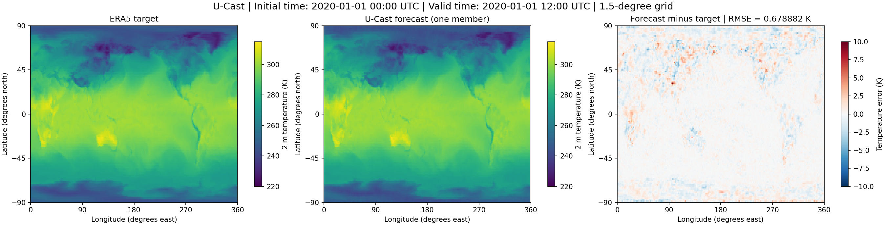

# U-Cast

This example implements U-Cast in PaddleScience, including two-stage training, MC-Dropout ensemble forecasting, autoregressive inference, and NetCDF export. Download the pretrained `ucast.pdparams` file from the [AI Studio U-Cast model space](https://aistudio.baidu.com/modelsdetail/56266/space).

Install PaddleScience using the [installation guide](../install_setup.md), then prepare the data and statistics described in Section 3.1. Run the following commands from `PaddleScience/examples/ucast`.

=== "Model Training Command"

    ``` sh
    # Stage 1: deterministic training
    python ucast.py mode=train \
      hydra.run.dir=./outputs_ucast/stage1 \
      DATA.data_dir=/path/to/era5 \
      DATA.stats_dir=./data/stats

    # Stage 2: probabilistic fine-tuning
    python ucast.py --config-name ucast_prob \
      hydra.run.dir=./outputs_ucast/stage2 \
      DATA.data_dir=/path/to/era5 \
      DATA.stats_dir=./data/stats \
      TRAIN.pretrained_model_path=./outputs_ucast/stage1/checkpoints/best_raw.pdparams
    ```

=== "Model Evaluation Command"

    ``` sh
    # Evaluate multi-step ensemble forecasts with Solver.eval()
    python ucast.py --config-name ucast_prob mode=eval \
      DATA.data_dir=/path/to/era5 \
      DATA.stats_dir=./data/stats \
      TRAIN.pretrained_model_path=./checkpoints/ucast.pdparams \
      INFER.pretrained_model_path=./checkpoints/ucast.pdparams
    ```

=== "Model Inference Command"

    ``` sh
    # Read public WeatherBench-2 ERA5 and run one 12-hour forecast first
    python ucast.py mode=infer \
      DATA.stats_dir=./data/stats \
      INFER.pretrained_model_path=./checkpoints/ucast.pdparams \
      INFER.ic_start_dates='[2020-01-01]' \
      INFER.ensemble_size=1 \
      INFER.ensemble_chunk_size=1 \
      INFER.prediction_horizon=1 \
      INFER.score=false \
      INFER.output_path=./outputs_ucast/forecast.nc
    ```

## 1. Background

Weather forecasts are uncertain. Ensemble forecasts describe this uncertainty by generating multiple possible future trajectories, supporting decisions such as extreme-weather warnings and energy scheduling. U-Cast uses a convolutional network based on the Dhariwal/ADM U-Net, generates ensemble members with MC-Dropout, and extends forecasts through autoregressive rollout.

This example uses the released model with approximately 895 million parameters, a 1.5° global grid of `240 × 121` longitude/latitude points, a 12-hour time step, and 83 surface and upper-air variables. Each forward pass predicts a state residual for one time step. Dropout remains active when generating ensemble members.

## 2. Model Principles

### 2.1 Inputs and Outputs

The network takes two historical weather states, four time-dependent forcing fields, and two static fields, for `2 × 83 + 4 + 2 = 172` channels. Spatial axes are ordered as `(longitude, latitude)`.

| Field | Channels | Description |
| --- | ---: | --- |
| `input` | 166 | 83 normalized variables at the current time and 12 hours earlier |
| `dynamical_condition` | 4 | Sine/cosine encodings of annual and local daily progress |
| `static_condition` | 2 | Land-sea mask and surface geopotential, standardized separately |
| `output` | 83 | Standardized state residual for the next time step |

For the physical state $X_t$, normalized state $Z_t=(X_t-\mu)/\sigma$, and network output $R_\theta$, prediction is:

$$
\widehat{Z}_{t+12\mathrm{h}} = Z_t + \frac{\sigma_{\Delta X}}{\sigma}
R_\theta(Z_{t-12\mathrm{h}}, Z_t, F_{t+12\mathrm{h}}, S),
\qquad
\widehat{X}_{t+12\mathrm{h}} = \sigma\widehat{Z}_{t+12\mathrm{h}}+\mu.
$$

Here, $F$ denotes time-dependent forcings, $S$ denotes static fields, and $\sigma_{\Delta X}$ is the residual standard deviation. The U-Net uses multiscale residual blocks and attention, with periodic padding along longitude. Feeding the predicted state back into the history window produces subsequent forecast steps.

### 2.2 Two-Stage Training and Ensembles

Stage 1 trains a single-member forecast using area- and variable-weighted mean absolute error (WMAE). Stage 2 initializes from stage 1 and fine-tunes with fair CRPS, using 2 MC-Dropout members for training and 5 for validation. For predictions $\{x_m\}_{m=1}^M$ and target $y$:

$$
\operatorname{fairCRPS} = \frac{1}{M}\sum_{m=1}^{M}|x_m-y|
-\frac{1}{2M(M-1)}\sum_{m\ne n}|x_m-x_n|.
$$

Probabilistic training requires $M\ge 2$. Set `INFER.ensemble_size` to control the number of inference members, or supply multiple checkpoints through `INFER.pretrained_model_paths` for a deep ensemble.

## 3. Model Construction

### 3.1 Environment and Data

This example has been validated with Python 3.10, PaddlePaddle GPU 3.3.1, and CUDA 11.8. Install the example dependencies from the PaddleScience repository root, then enter the example directory:

``` sh
python -m pip install -r examples/ucast/requirements.txt
cd examples/ucast
mkdir -p data/stats checkpoints
```

The example uses ERA5 reanalysis data released by [WeatherBench-2](https://github.com/google-research/weatherbench2). The default dataset is:

``` yaml
DATA:
  data_dir: gs://weatherbench2/datasets/era5
  dataset: 1959-2023_01_10-6h-240x121_equiangular_with_poles_conservative.zarr
  stats_dir: ./data/stats
  window: 2
  hourly_resolution: 12
```

Data are read on demand using anonymous GCS access, which requires network access to the storage service. For a local dataset, set `DATA.data_dir` to the parent directory of the Zarr store:

``` text
/path/to/era5/
└── 1959-2023_01_10-6h-240x121_equiangular_with_poles_conservative.zarr/
```

The 83 predicted variables comprise 5 surface variables (mean sea-level pressure, 10 m zonal and meridional wind, 2 m temperature, and sea-surface temperature) and 6 upper-air variables (geopotential, specific humidity, temperature, zonal and meridional wind, and vertical velocity) at 13 pressure levels: `50, 100, 150, 200, 250, 300, 400, 500, 600, 700, 850, 925, 1000 hPa`. The dataset must also contain `land_sea_mask` and `geopotential_at_surface`.

Download the following four files from the [original statistics directory](https://github.com/Rose-STL-Lab/u-cast/tree/main/data/stats) into `data/stats/`:

``` text
data/stats/
├── era5_mean.nc
├── era5_std.nc
├── era5_residual_std.nc
└── era5_min.nc
```

These statistics are paired with the released weights and are used for normalization, residual reconstruction, and missing sea-surface-temperature values.

!!! note "Required time coverage"

    The minimal inference example initializes at `2020-01-01 00:00` and needs data at `2019-12-31 12:00`, `2020-01-01 00:00`, and `2020-01-01 12:00`. The current entry point also loads future targets, so the complete forecast time range is required even with `INFER.score=false`. Full training defaults to 1979–2019, with validation in 2020. Adjust both time ranges when using a smaller dataset.

### 3.2 Pretrained Weights

Download `ucast.pdparams` from the [AI Studio U-Cast model space](https://aistudio.baidu.com/modelsdetail/56266/space) and save it as `checkpoints/ucast.pdparams`.

This approximately 3.58 GB file was converted from the original released PyTorch EMA weights and can be used directly for Paddle inference. It contains model parameters only. To resume a complete training run, use the training checkpoints generated by this example.

### 3.3 Network, Constraint, and Solver

Construct the network with `ppsci.arch.UCast(**cfg.MODEL)`. The default configuration is `examples/ucast/conf/ucast.yaml`, and the stage-2 configuration is `examples/ucast/conf/ucast_prob.yaml`.

`ERA5WindowDataset` reads weather windows, and `SupervisedWindows` adapts them into PaddleScience input, label, and weight dictionaries. Training uses `SupervisedConstraint` and `FunctionalLoss`:

``` py title="examples/ucast/ucast_solver.py"
--8<--
examples/ucast/ucast_solver.py:209:218
--8<--
```

The model, training constraint, optimizer, and validator are passed to the shared `ppsci.solver.Solver`:

``` py title="examples/ucast/ucast_solver.py"
--8<--
examples/ucast/ucast_solver.py:223:243
--8<--
```

Training runs through `Solver.train()`. Validation uses `SupervisedValidator`, `FunctionalMetric`, and `Solver.eval()`. The example integrates a hybrid Muon/AdamW optimizer, gradient accumulation, warmup/cosine learning rates, and EMA updates without modifying the shared Solver.

### 3.4 Training and Resuming

Replace `/path/to/era5` with the actual dataset directory before running the training commands above. Stage 1 defaults to 100 epochs and stage 2 to 12 epochs. The single-GPU effective batch size is `TRAIN.batch_size × TRAIN.update_freq`, which defaults to 48 for both stages.

For limited GPU memory, use `--config-name ucast_3090` and `--config-name ucast_prob_3090`. These enable recomputation, set training batch size to 1, and split validation forward passes into individual samples. These parameters can also be adjusted to fit the available memory.

Stage 1 selects its best checkpoint by validation RMSE; stage 2 uses fair CRPS. `best.pdparams` / `last.pdparams` contain EMA inference weights. The `best_raw` / `last_raw` file groups retain raw parameters and complete training state.

Resume with `TRAIN.checkpoint_path`, keeping the original model, data, optimizer, total epochs, and batch settings:

``` sh
python ucast.py mode=train \
  hydra.run.dir=./outputs_ucast/stage1 \
  DATA.data_dir=/path/to/era5 \
  DATA.stats_dir=./data/stats \
  TRAIN.checkpoint_path=./outputs_ucast/stage1/checkpoints/last_raw
```

### 3.5 Inference and Metrics

Start with the single-member, single-step command above to check weight loading and data access. To generate a 15-day ensemble and save per-variable RMSE and fair CRPS, run:

``` sh
python ucast.py mode=infer \
  DATA.stats_dir=./data/stats \
  INFER.pretrained_model_path=./checkpoints/ucast.pdparams \
  INFER.ic_start_dates='[2020-01-01]' \
  INFER.ensemble_size=5 \
  INFER.ensemble_chunk_size=1 \
  INFER.prediction_horizon=30 \
  INFER.score=true \
  INFER.output_path=./outputs_ucast/forecast.nc \
  INFER.score_output_path=./outputs_ucast/scores.json
```

`prediction_horizon` counts 12-hour steps, so 30 steps correspond to 15 days. `ensemble_chunk_size=1` processes members individually to reduce GPU memory use. Add `DATA.data_dir=/path/to/era5` for local data.

NetCDF forecast variables end with `_predicted` and have dimensions `(init_time, ensemble_member, lead_time, longitude, latitude)`. Targets end with `_target` and omit the ensemble dimension. Values are restored to physical units and can be read with xarray.

## 4. Results

### 4.1 Migration Accuracy

Network outputs were compared between the original PyTorch and Paddle implementations using identical inputs and released EMA weights, in FP32 with TF32 disabled by `NVIDIA_TF32_OVERRIDE=0`. Relative L2 error is $\|y_{\mathrm{Paddle}}-y_{\mathrm{PyTorch}}\|_2/\|y_{\mathrm{PyTorch}}\|_2$.

| Comparison | Maximum absolute error | Relative L2 error |
| --- | ---: | ---: |
| Small network, nonzero random weights | 6.0796738e-06 | 2.5403265e-06 |
| Full released model, 240 × 121 grid | 3.4540892e-05 | 4.0156247e-06 |

After three prescribed gradient updates, the maximum parameter differences were `7.4505806e-09` for Muon and `2.3283064e-10` for AdamW. Full-size synthetic training completed an optimizer and EMA update in each stage; all 518 parameter tensors had gradients with finite gradient norms.

### 4.2 One-Step ERA5 Forecast

The figure shows a real ERA5 functional check with the released weights: initial time `2020-01-01 00:00`, 12-hour lead time, and one ensemble member. The panels show 2 m temperature targets, predictions, and errors in K.

<figure markdown>
  { loading=lazy }
  <figcaption>2 m temperature at 2020-01-01 12:00: ERA5 target, U-Cast forecast, and error.</figcaption>
</figure>

All 83 predicted variables were finite, and exported NetCDF time coordinates and dimensions passed validation. Using the inference entry point's latitude weighting, RMSE was `0.678882 K` for 2 m temperature, `0.736429 m/s` for 10 m zonal wind, and `0.777447 m/s` for 10 m meridional wind. These values describe only this initial condition and one forecast step. Full-length training and paper-level skill reproduction have not been performed; this check does not replace annual or long-range ensemble evaluation. The single-member check is not used to assess ensemble fair CRPS.

## 5. Complete Code

The entry point is shown below. Data processing, training, and Solver adaptation are implemented in `ucast_utils.py`, `ucast_data.py`, `ucast_training.py`, and `ucast_solver.py` in the same example directory.

``` py linenums="1" title="examples/ucast/ucast.py"
--8<--
examples/ucast/ucast.py
--8<--
```

## 6. References

- [U-Cast: A Surprisingly Simple and Efficient Frontier AI Probabilistic Weather Forecaster](https://arxiv.org/abs/2604.09041)
- [Original U-Cast repository](https://github.com/Rose-STL-Lab/u-cast)
- [WeatherBench-2](https://github.com/google-research/weatherbench2)
- [AI Studio U-Cast Paddle weights](https://aistudio.baidu.com/modelsdetail/56266/space)
