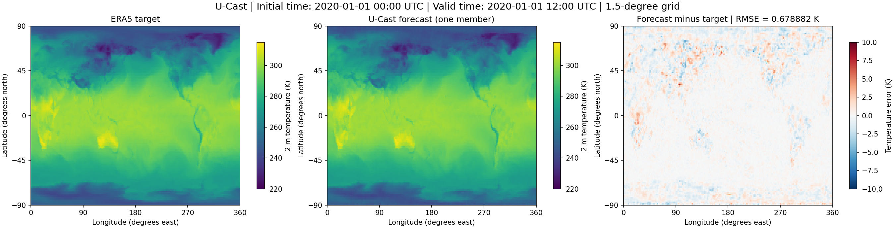

# U-Cast

本案例提供 U-Cast 的 PaddleScience 实现，支持两阶段训练、MC-Dropout 集合预报、自回归推理和 NetCDF 结果导出。预训练权重可从[飞桨星河 U-Cast 模型空间](https://aistudio.baidu.com/modelsdetail/56266/space)下载，文件名为 `ucast.pdparams`。

运行前请先按[安装说明](../install_setup.md)安装 PaddleScience，并按第 3.1 节准备数据和统计文件。以下命令均在 `PaddleScience/examples/ucast` 目录执行。

=== "模型训练命令"

    ``` sh
    # 第一阶段：确定性训练
    python ucast.py mode=train \
      hydra.run.dir=./outputs_ucast/stage1 \
      DATA.data_dir=/path/to/era5 \
      DATA.stats_dir=./data/stats

    # 第二阶段：概率微调
    python ucast.py --config-name ucast_prob \
      hydra.run.dir=./outputs_ucast/stage2 \
      DATA.data_dir=/path/to/era5 \
      DATA.stats_dir=./data/stats \
      TRAIN.pretrained_model_path=./outputs_ucast/stage1/checkpoints/best_raw.pdparams
    ```

=== "模型评估命令"

    ``` sh
    # 使用 Solver.eval() 评估验证集上的多步集合预报
    python ucast.py --config-name ucast_prob mode=eval \
      DATA.data_dir=/path/to/era5 \
      DATA.stats_dir=./data/stats \
      TRAIN.pretrained_model_path=./checkpoints/ucast.pdparams \
      INFER.pretrained_model_path=./checkpoints/ucast.pdparams
    ```

=== "模型推理命令"

    ``` sh
    # 默认在线读取 WeatherBench-2 ERA5，先运行一次 12 小时预报
    python ucast.py mode=infer \
      DATA.stats_dir=./data/stats \
      INFER.pretrained_model_path=./checkpoints/ucast.pdparams \
      INFER.ic_start_dates='[2020-01-01]' \
      INFER.ensemble_size=1 \
      INFER.ensemble_chunk_size=1 \
      INFER.prediction_horizon=1 \
      INFER.score=false \
      INFER.output_path=./outputs_ucast/forecast.nc
    ```

## 1. 背景简介

天气预报存在不确定性。集合预报通过生成多条可能的未来天气轨迹，描述这种不确定性，辅助极端天气预警和能源调度等决策。U-Cast 使用基于 Dhariwal/ADM U-Net 的卷积网络，通过 MC-Dropout 生成集合成员，并使用自回归方式扩展预报时长。

本案例使用约 8.95 亿参数的发布模型，空间分辨率为 1.5°，经纬度网格为 `240 × 121`，时间步长为 12 小时，预测 83 个地面和高空气象变量。网络每次前向预测一个时间步的状态残差；生成多个集合成员时保留 Dropout 的随机性。

## 2. 模型原理

### 2.1 输入与输出

模型输入由两个历史天气状态、四个时间强迫场和两个静态场组成，总通道数为 `2 × 83 + 4 + 2 = 172`。张量的空间轴顺序为 `(longitude, latitude)`。

| 输入字段 | 通道数 | 含义 |
| --- | ---: | --- |
| `input` | 166 | 当前时刻和前 12 小时的 83 个归一化天气变量 |
| `dynamical_condition` | 4 | 年周期和当地日周期的正弦、余弦编码 |
| `static_condition` | 2 | 陆海掩码和地表位势，分别进行标准化 |
| `output`（输出） | 83 | 下一时刻的标准化状态残差 |

设物理天气状态为 $X_t$，归一化状态为 $Z_t=(X_t-\mu)/\sigma$，网络输出为 $R_\theta$，则预测过程为：

$$
\widehat{Z}_{t+12\mathrm{h}} = Z_t + \frac{\sigma_{\Delta X}}{\sigma}
R_\theta(Z_{t-12\mathrm{h}}, Z_t, F_{t+12\mathrm{h}}, S),
\qquad
\widehat{X}_{t+12\mathrm{h}} = \sigma\widehat{Z}_{t+12\mathrm{h}}+\mu.
$$

其中 $F$ 为时间强迫场，$S$ 为静态场，$\sigma_{\Delta X}$ 为残差标准差。U-Net 使用多尺度残差块和注意力模块，经度方向采用周期边界填充。将预测状态加入历史窗口，即可继续生成后续预报。

### 2.2 两阶段训练与集合预报

第一阶段使用面积和变量加权的平均绝对误差（WMAE）训练单成员预报；第二阶段加载第一阶段权重，使用 fair CRPS 微调，训练时生成 2 个 MC-Dropout 成员，验证时使用 5 个成员。对于集合预测 $\{x_m\}_{m=1}^M$ 和真值 $y$，fair CRPS 为：

$$
\operatorname{fairCRPS} = \frac{1}{M}\sum_{m=1}^{M}|x_m-y|
-\frac{1}{2M(M-1)}\sum_{m\ne n}|x_m-x_n|.
$$

概率训练要求 $M\ge 2$。推理可以通过 `INFER.ensemble_size` 指定成员数，也可以通过 `INFER.pretrained_model_paths` 加载多个 checkpoint 进行深度集成。

## 3. 模型构建

### 3.1 环境与数据准备

本案例已在 Python 3.10、PaddlePaddle GPU 3.3.1、CUDA 11.8 环境验证。先从 PaddleScience 仓库根目录安装案例依赖，再进入案例目录：

``` sh
python -m pip install -r examples/ucast/requirements.txt
cd examples/ucast
mkdir -p data/stats checkpoints
```

数据使用 [WeatherBench-2](https://github.com/google-research/weatherbench2) 发布的 ERA5 再分析数据，默认配置为：

``` yaml
DATA:
  data_dir: gs://weatherbench2/datasets/era5
  dataset: 1959-2023_01_10-6h-240x121_equiangular_with_poles_conservative.zarr
  stats_dir: ./data/stats
  window: 2
  hourly_resolution: 12
```

默认通过匿名 GCS 访问按需读取数据，需要能够访问上述存储服务。使用本地数据时，把 `DATA.data_dir` 改为 Zarr 数据集的父目录；目录结构如下：

``` text
/path/to/era5/
└── 1959-2023_01_10-6h-240x121_equiangular_with_poles_conservative.zarr/
```

83 个预测变量包含 5 个地面变量：海平面气压、10 米纬向风、10 米经向风、2 米气温、海表温度；以及 6 类高空变量：位势、比湿、温度、纬向风、经向风、垂直速度，在 `50, 100, 150, 200, 250, 300, 400, 500, 600, 700, 850, 925, 1000 hPa` 共 13 个气压层上的取值。数据还需包含 `land_sea_mask` 和 `geopotential_at_surface`。

从[原项目统计文件目录](https://github.com/Rose-STL-Lab/u-cast/tree/main/data/stats)下载以下四个文件，放入 `data/stats/`：

``` text
data/stats/
├── era5_mean.nc
├── era5_std.nc
├── era5_residual_std.nc
└── era5_min.nc
```

这些文件用于变量归一化、残差还原和海表温度缺失值填充，应与发布权重配套使用。

!!! note "时间范围"

    最小推理示例以 `2020-01-01 00:00` 为初始时刻，需要包含 `2019-12-31 12:00`、`2020-01-01 00:00` 和 `2020-01-01 12:00` 的数据。当前入口同时读取未来真值，因此即使设置 `INFER.score=false`，也需要覆盖完整预报时间范围。完整训练默认使用 1979—2019 年，验证使用 2020 年；数据不足时需同步调整训练、验证时间范围。

### 3.2 预训练权重

从[飞桨星河 U-Cast 模型空间](https://aistudio.baidu.com/modelsdetail/56266/space)下载 `ucast.pdparams`，放置到 `checkpoints/ucast.pdparams`。

该文件由 U-Cast 原项目发布的 PyTorch EMA 权重转换得到，大小约 3.58 GB，可直接用于 Paddle 推理，无需再执行 PyTorch 权重转换。文件仅包含模型参数；恢复完整训练状态应使用本案例训练生成的断点文件。

### 3.3 网络、约束与求解器

使用 `ppsci.arch.UCast(**cfg.MODEL)` 构建网络。模型默认配置位于 `examples/ucast/conf/ucast.yaml`，第二阶段配置位于 `examples/ucast/conf/ucast_prob.yaml`。

训练数据通过 `ERA5WindowDataset` 按时间窗口读取，经 `SupervisedWindows` 适配为 PaddleScience 的输入、标签和权重字典。训练约束使用 `SupervisedConstraint` 和 `FunctionalLoss`：

``` py title="examples/ucast/ucast_solver.py"
--8<--
examples/ucast/ucast_solver.py:209:218
--8<--
```

随后把模型、训练约束、优化器和验证器交给通用 `ppsci.solver.Solver`：

``` py title="examples/ucast/ucast_solver.py"
--8<--
examples/ucast/ucast_solver.py:223:243
--8<--
```

训练通过 `Solver.train()` 执行，验证使用 `SupervisedValidator`、`FunctionalMetric` 和 `Solver.eval()`。Muon 与 AdamW 混合优化器、梯度累积、warmup/cosine 学习率以及 EMA 更新由案例代码接入；未修改通用 Solver。

### 3.4 训练与恢复

运行页首训练命令前，将 `/path/to/era5` 替换为实际数据目录。默认第一阶段训练 100 个 epoch，第二阶段 12 个 epoch。单卡有效 batch size 为 `TRAIN.batch_size × TRAIN.update_freq`，默认两阶段均为 48。

显存不足时可使用 `--config-name ucast_3090` 和 `--config-name ucast_prob_3090`：它们启用重计算，将训练 batch size 设为 1，并将验证前向拆分为单样本处理。也可以按显存调整上述参数。

第一阶段按验证集 RMSE 选择最佳模型，第二阶段按 fair CRPS 选择最佳模型。`best.pdparams` / `last.pdparams` 为推理用 EMA 权重；`best_raw` / `last_raw` 文件组保留原始参数和完整训练状态。

恢复训练时使用 `TRAIN.checkpoint_path`，并保持原模型、数据、优化器、总 epoch 数和 batch 配置一致：

``` sh
python ucast.py mode=train \
  hydra.run.dir=./outputs_ucast/stage1 \
  DATA.data_dir=/path/to/era5 \
  DATA.stats_dir=./data/stats \
  TRAIN.checkpoint_path=./outputs_ucast/stage1/checkpoints/last_raw
```

### 3.5 推理与指标

先运行页首的单成员、单步命令，验证权重加载和数据读取。需要生成 15 天集合预报并保存逐变量 RMSE、fair CRPS 时，可运行：

``` sh
python ucast.py mode=infer \
  DATA.stats_dir=./data/stats \
  INFER.pretrained_model_path=./checkpoints/ucast.pdparams \
  INFER.ic_start_dates='[2020-01-01]' \
  INFER.ensemble_size=5 \
  INFER.ensemble_chunk_size=1 \
  INFER.prediction_horizon=30 \
  INFER.score=true \
  INFER.output_path=./outputs_ucast/forecast.nc \
  INFER.score_output_path=./outputs_ucast/scores.json
```

`prediction_horizon` 的单位为 12 小时，30 步对应 15 天。`ensemble_chunk_size=1` 逐个处理成员以降低显存占用。使用本地 ERA5 时，在命令中增加 `DATA.data_dir=/path/to/era5`。

NetCDF 中，预报变量以 `_predicted` 结尾，维度为 `(init_time, ensemble_member, lead_time, longitude, latitude)`；真值以 `_target` 结尾，不含集合成员维度。结果已还原为物理量，可用 xarray 读取。

## 4. 结果展示

### 4.1 迁移精度对齐

采用相同输入和发布 EMA 权重，对比 PyTorch 原实现与 Paddle 实现的网络输出；使用 FP32，并设置 `NVIDIA_TF32_OVERRIDE=0` 关闭 TF32。相对 L2 误差定义为 $\|y_{\mathrm{Paddle}}-y_{\mathrm{PyTorch}}\|_2/\|y_{\mathrm{PyTorch}}\|_2$。

| 对齐项目 | 最大绝对误差 | 相对 L2 误差 |
| --- | ---: | ---: |
| 小网络，非零随机权重 | 6.0796738e-06 | 2.5403265e-06 |
| 完整发布模型，240 × 121 网格 | 3.4540892e-05 | 4.0156247e-06 |

在给定梯度序列的 3 次更新后，Muon 参数最大差异为 `7.4505806e-09`，AdamW 参数最大差异为 `2.3283064e-10`。完整模型的两阶段合成数据训练均已完成一次优化器和 EMA 更新，518 个参数张量均有梯度且梯度范数有限。

### 4.2 ERA5 单步预报

下图来自发布权重的真实 ERA5 功能测试：初始时刻为 `2020-01-01 00:00`，预报时效为 12 小时，集合成员数为 1。图中展示 2 米气温真值、预报和预报误差，单位为 K。

<figure markdown>
  { loading=lazy }
  <figcaption>2020-01-01 12:00 的 2 米气温：ERA5 真值、U-Cast 预报及误差。</figcaption>
</figure>

该样本 83 个预测变量均为有限值，导出的 NetCDF 时间和维度检查通过。按推理入口的纬度加权方式计算，2 米气温 RMSE 为 `0.678882 K`，10 米纬向风 RMSE 为 `0.736429 m/s`，10 米经向风 RMSE 为 `0.777447 m/s`。这些数值仅对应本次单初始时刻、单步测试；未进行完整训练和论文级预报精度复现，不能据此替代全年或长时效集合评估。单成员测试不用于评估集合 fair CRPS。

## 5. 完整代码

案例入口如下；数据处理、训练和 Solver 适配代码分别位于同目录的 `ucast_utils.py`、`ucast_data.py`、`ucast_training.py` 和 `ucast_solver.py`。

``` py linenums="1" title="examples/ucast/ucast.py"
--8<--
examples/ucast/ucast.py
--8<--
```

## 6. 参考资料

- [U-Cast: A Surprisingly Simple and Efficient Frontier AI Probabilistic Weather Forecaster](https://arxiv.org/abs/2604.09041)
- [U-Cast 原项目](https://github.com/Rose-STL-Lab/u-cast)
- [WeatherBench-2](https://github.com/google-research/weatherbench2)
- [飞桨星河 U-Cast Paddle 权重](https://aistudio.baidu.com/modelsdetail/56266/space)
