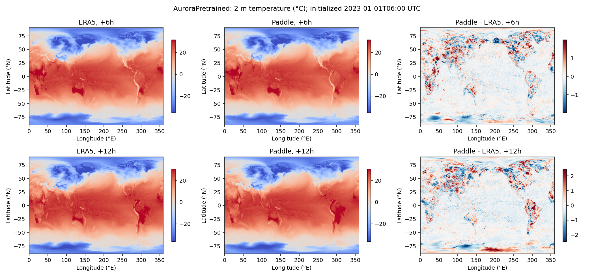
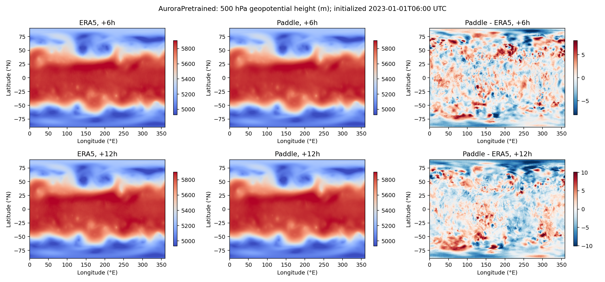

# Aurora

Native Paddle implementation of [Microsoft Aurora](https://github.com/microsoft/aurora),
pinned to `85dd3880683f0ac19aa8fe4386c5dcacfec99892` and retaining the upstream MIT license.
`AuroraArch` connects variable patch embeddings, Perceiver encoding/decoding and a
3D Swin U-Net to PaddleScience's dictionary interface and `Solver`.

Full-checkpoint validation covers `AuroraPretrained` (1,256,300,176 parameters).
Other variants retain their architectures but have not been validated with their
own complete pretrained weights. Run commands from the PaddleScience repository root.

## Installation and offline demonstration

The verified environment is Python 3.10, PaddlePaddle GPU 3.4.0, CUDA 12.9 and RTX 3090.
Install PaddlePaddle using its official instructions, then:

```sh
python -m pip install -e .
python -m pip install -r examples/aurora/requirements.txt
python examples/aurora/prepare_demo.py
python examples/aurora/finetune.py --config-name tiny
python examples/aurora/finetune.py --config-name tiny mode=eval \
  MODEL.checkpoint=outputs/aurora-tiny/model.pdparams
python examples/aurora/predict.py --tiny --output outputs/aurora-demo
```

The reduced Tiny architecture and synthetic data demonstrate forward/backward
execution and checkpoint reloading. They do not measure weather forecast skill.
Tiny weights are incompatible with the complete pretrained model.

## Native weights

Use `aurora-pretrained.pdparams` (5,025,272,922 bytes, approximately 4.68 GiB).
Its SHA256 is `eb586812d66fea058522700165b2858540bb8b15144390f9255fae434cd44d81`.
**Public checkpoint hosting on AI Studio is pending.** The commands below require
this native checkpoint at `checkpoints/aurora-pretrained.pdparams`.
The implementation loads native Paddle parameters directly.

## ERA5 data

Download the public WeatherBench2 ERA5 subset at 0.25-degree resolution with 13
pressure levels. The source ends at 2023-01-10 18:00 UTC. `--start` is UTC;
the download includes two historical frames and `--steps` future frames, six hours apart.

```sh
python examples/aurora/download_era5.py --start 2023-01-01 --steps 2 \
  --directory data/aurora
python examples/aurora/prepare_era5.py --directory data/aurora
```

The downloader verifies cached data and records SHA256 and source ETags. Reserve
space for source chunks and prepared NetCDF files. Proxy environment settings
are honored; `--direct` selects direct HTTPS and `--request-bytes 4194304` enables
bounded range requests.

Required variables are surface `2t, 10u, 10v, msl`, atmosphere `z, u, v, t, q`,
and static `lsm, z, slt`. Pressure levels in hPa are
`50,100,150,200,250,300,400,500,600,700,850,925,1000`.
Surface shape is `(B,T,H,W)`, atmosphere `(B,T,C,H,W)`, and static `(H,W)`.
Inputs have `T=2`, targets `T=1`; latitude decreases and longitude is in `[0,360)`.
Metadata time is the last historical frame's UTC time. The model crops incomplete
latitude patches (`721 -> 720`); evaluation strictly aligns coordinates and times.

## Inference and evaluation

```sh
CUDA_VISIBLE_DEVICES=0 NVIDIA_TF32_OVERRIDE=0 python examples/aurora/predict.py \
  --device gpu:0 --steps 2 --checkpoint checkpoints/aurora-pretrained.pdparams \
  --input data/aurora/input.nc --output outputs/aurora-era5
python examples/aurora/evaluate_era5.py --data data/aurora \
  --prediction outputs/aurora-era5 --steps 2 --output outputs/aurora-era5/metrics
python examples/aurora/plot_era5.py --data data/aurora \
  --prediction outputs/aurora-era5 --steps 2 --output outputs/aurora-era5/figures
```

FP32 attention and decoder locations are processed in independent chunks. The
decoder batch defaults to 2048 locations. Full-grid inference previously measured
17.83 GiB peak allocated GPU memory. Full-resolution global training is not validated.

Metrics use cosine-latitude-weighted RMSE in physical units. Persistence holds the
last input state constant. Results below use initialization 2023-01-01 06:00 UTC,
720x1440 forecast points and all 13 pressure levels.

| Variable | Unit | +6h RMSE | +6h persistence | +12h RMSE | +12h persistence |
| --- | --- | --- | --- | --- | --- |
| 2 m temperature | K | 0.491621 | 2.82432 | 0.612136 | 3.25386 |
| 10 m u-wind | m/s | 0.523374 | 1.95561 | 0.636562 | 2.77033 |
| 10 m v-wind | m/s | 0.533163 | 2.31386 | 0.655754 | 3.38663 |
| Mean sea level pressure | Pa | 31.9165 | 264.613 | 38.4941 | 358.009 |
| Temperature at 850 hPa | K | 0.432024 | 1.49239 | 0.485647 | 2.07166 |
| Geopotential at 500 hPa | m²/s² | 23.9960 | 222.807 | 29.2050 | 338.332 |

[](../../docs/images/aurora/temperature.png)

[](../../docs/images/aurora/z500.png)

Rows show +6h and +12h; columns show ERA5, Paddle and Paddle minus ERA5.
The temperature plot uses degrees Celsius. The geopotential plot divides by
9.80665 m/s² to display height in metres; the table retains native geopotential units.
Field colors span the truth's 1st–99th percentiles; error colors use its absolute
99th percentile, so extremes may saturate. This is a single initialization,
not a statistical benchmark. ACC is not reported without climatology.

## Supervised fine-tuning

```sh
CUDA_VISIBLE_DEVICES=0 NVIDIA_TF32_OVERRIDE=0 python examples/aurora/finetune.py \
  device=gpu:0 MODEL.checkpoint=checkpoints/aurora-pretrained.pdparams
python examples/aurora/finetune.py mode=eval \
  MODEL.checkpoint=outputs/aurora-finetune/model.pdparams
```

`conf/aurora.yaml` builds `AuroraArch` through `ppsci.arch.build_model` and connects
`NamedArrayDataset`, `SupervisedConstraint`, Adam, `SupervisedValidator` and `Solver`.
The loss averages nine per-variable MSEs divided by the squared official
variable/pressure-level scales. `DATA.spatial_stride=45` retains all pressure levels
on a bounded grid. Input/target timestamps, levels and coordinates are checked.

This example trains and evaluates the same single forecast pair, demonstrating
the workflow rather than held-out accuracy or convergence. Random initialization
requires `TRAIN.allow_random_init=true`; evaluation requires a checkpoint.
`model.pdparams` contains native model weights; Solver also saves training state.

## CINN verification

The compiler entry point enables CINN before importing Paddle and compiles the
Swin3D backbone with `paddle.jit.to_static(backend="CINN", full_graph=False)`.
Encoder, decoder, metadata and NetCDF processing remain eager. Unsupported
operators may run through native Paddle kernels; this is subgraph compilation.

```sh
CUDA_VISIBLE_DEVICES=0 bash examples/aurora/run_cinn.sh --tiny \
  --input data/aurora-demo/input.nc --target data/aurora-demo/truth_001.nc \
  --output outputs/aurora-cinn-tiny
CUDA_VISIBLE_DEVICES=0 bash examples/aurora/run_cinn.sh \
  --checkpoint checkpoints/aurora-pretrained.pdparams --input data/aurora/input.nc \
  --train-steps 0 --output outputs/aurora-cinn-full
```

Set `PYTHON` to select the active environment's interpreter if necessary. The
full-model check samples a 17x32 grid with all 13 pressure levels. It checks
inference only; the Tiny example also performs two SGD updates and checks finite
gradients/losses. Each run writes `cinn.json` and `execution.paddle_trace.json`.
Success requires actual `cinn_jit` operator executions in the trace and per-variable
normalized absolute error <=1e-4 and relative L2 <=1e-5 against eager predictions.

| Configuration | Training updates | Max normalized absolute error | Max relative L2 | Recorded CINN operator executions |
| --- | --- | --- | --- | --- |
| Tiny, 17x32 synthetic grid, 4 levels | 2 | 2.84e-6 | 9.05e-7 | 16 |
| Full pretrained, 17x32 ERA5 grid, 13 levels | 0 | 1.26e-5 | 2.87e-6 | 6 |

Counts refer to the recorded execution phase, not the number of compiled kernels
or a coverage percentage. Both checks passed in the environment above. These
results do not certify whole-model full-graph compilation, global full-resolution
CINN training, or a performance speedup.
